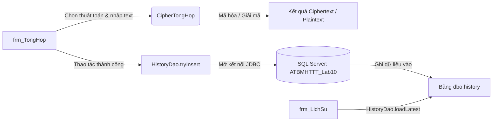

# LAB 1 – Mã Hóa Đối Xứng Cổ Điển (Classical Symmetric Ciphers)
## Java Swing (GUI) – Apache Maven – Microsoft SQL Server 2022

**Họ và tên:** Trần Nguyễn Minh Khôi  
**MSSV:** 1150080059  
**Lớp:** 11_ĐH_CNPM1  
**Học phần:** An toàn và Bảo mật Thông tin  
**Năm học:** 2026–2027  
**Youtube:** https://www.youtube.com/@Tr%E1%BA%A7nNguy%E1%BB%85nMinhKh%C3%B4i-22  

---

## 1. Thông Tin Tổng Quan & Môi Trường Hoạt Động

| Mục | Thông tin chi tiết |
|---|---|
| **Tên bài Lab** | MÃ HÓA ĐỐI XỨNG CỔ ĐIỂN (LAB 1 / Tuần 10 thực hành) |
| **Giao diện & Nền tảng** | Java Swing (NetBeans GUI Builder compatible), JDK 17/25 (Adoptium Temurin 25.0.4.1) |
| **Quản lý dự án** | Apache Maven 3.9.6 (Project `LAB1_MaHoaCoDien`, Package `week_01`) |
| **Cơ sở dữ liệu** | Microsoft SQL Server 2022 Express Edition (Port `1433`) |
| **Database & Schema** | Database `ATBMHTTT_Lab10` (và `LAB1_MaHoaCoDien`), schema `dbo`, bảng `history` |
| **Chuỗi kết nối** | `DATABASE_URL=sqlserver://localhost:1433;database=ATBMHTTT_Lab10;integratedSecurity=true;trustServerCertificate=true;schema=dbo` |
| **Tài khoản SQL** | `lab1_user` (mật khẩu: `LabUser@2026`) & Windows Integrated Security |

---

## 2. Cấu Trúc Thư Mục Dự Án

```
LAB10/
├── 03_SQL_SERVER/
│   ├── 01_Tao_CSDL.sql              # Script tạo database và bảng dbo.history
│   ├── 02_Tao_Login_MAU.sql         # Script tạo login lab1_user và cấp quyền
│   └── 03_Kiem_Tra_Du_Lieu.sql      # Script kiểm tra, đếm bản ghi lịch sử
├── LAB1_MaHoaCoDien/
│   ├── pom.xml                      # Cấu hình Maven, Java 17, MSSQL JDBC driver, JUnit 5
│   └── src/
│       ├── main/java/week_01/
│       │   ├── FileTextIO.java            # Đọc/ghi file UTF-8 với JFileChooser
│       │   ├── CaesarCipher.java          # Thuật toán Caesar
│       │   ├── VigenereCipher.java        # Thuật toán Vigenère
│       │   ├── RailFenceCipher.java       # Thuật toán Rail Fence (hàng rào zíc-zắc)
│       │   ├── PlayfairCipher.java        # Thuật toán Playfair ma trận 5x5
│       │   ├── TranspositionCipher.java   # Thuật toán Hoán vị cột
│       │   ├── AutokeyCipher.java         # Thuật toán Autokey
│       │   ├── CipherTongHop.java         # Lớp tổng hợp 6 thuật toán & gợi ý khóa
│       │   ├── DbConfig.java              # Quản lý kết nối JDBC SQL Server an toàn
│       │   ├── HistoryDao.java            # Tương tác bảng dbo.history (PreparedStatement)
│       │   ├── AttackDemos.java           # 3 kỹ thuật thám mã (Brute force, Frequency, Known-plain)
│       │   ├── frm_Caesar.java            # Form GUI mã hóa Caesar
│       │   ├── frm_Vigenere.java          # Form GUI mã hóa Vigenère
│       │   ├── frm_RailFence.java         # Form GUI mã hóa Rail Fence
│       │   ├── frm_Playfair.java          # Form GUI mã hóa Playfair + ma trận khóa
│       │   ├── frm_Transposition.java     # Form GUI mã hóa Hoán vị cột
│       │   ├── frm_Autokey.java           # Form GUI mã hóa Autokey
│       │   ├── frm_TongHop.java           # Form tổng hợp 6 thuật toán + SQL logging
│       │   ├── frm_KetNoiSQL.java         # Form cấu hình & kiểm tra kết nối SQL Server
│       │   ├── frm_LichSu.java            # Form xem bảng lịch sử thao tác từ SQL Server
│       │   ├── frm_TanCong.java           # Form demo 3 kỹ thuật tấn công giải mã
│       │   └── frm_Menu.java              # Menu điều hướng chính (Main entry point)
│       └── test/java/week_01/
│           ├── CiphersTest.java           # Unit test toàn bộ 6 ciphers & attacks
│           └── DbTest.java                # Unit test kết nối SQL Server & ghi lịch sử
├── pom.xml                          # Maven root aggregator
├── Lab10_CNPM1_1150080059_Trần_Nguyễn_Minh_Khôi.docx
└── README.md
```

---

## 3. Cấu Hình Cơ Sở Dữ Liệu SQL Server

### 3.1. Tạo bảng `dbo.history`
Bảng lưu vết mọi thao tác Encrypt/Decrypt của người dùng, sử dụng ràng buộc kiểm tra toàn vẹn dữ liệu:

```sql
USE [ATBMHTTT_Lab10];
GO
IF OBJECT_ID(N'dbo.history', N'U') IS NULL 
BEGIN 
    CREATE TABLE dbo.history ( 
        id BIGINT IDENTITY(1,1) NOT NULL PRIMARY KEY, 
        created_at DATETIME2(0) NOT NULL DEFAULT SYSDATETIME(), 
        algorithm NVARCHAR(50) NOT NULL, 
        operation VARCHAR(10) NOT NULL, 
        input_text NVARCHAR(MAX) NOT NULL, 
        result_text NVARCHAR(MAX) NOT NULL, 
        CONSTRAINT CK_lab1_operation CHECK (operation IN ('ENCRYPT','DECRYPT')) 
    ); 
END; 
GO
```

### 3.2. Cấu hình tài khoản `lab1_user`
```sql
USE [master];
GO
IF NOT EXISTS (SELECT 1 FROM sys.sql_logins WHERE name = N'lab1_user') 
BEGIN 
    CREATE LOGIN [lab1_user] 
    WITH PASSWORD = 'LabUser@2026', 
    CHECK_POLICY = ON, 
    CHECK_EXPIRATION = OFF; 
END; 
GO
USE [ATBMHTTT_Lab10];
GO
IF NOT EXISTS (SELECT 1 FROM sys.database_principals WHERE name = N'lab1_user') 
    CREATE USER [lab1_user] FOR LOGIN [lab1_user]; 
GO
GRANT SELECT, INSERT, DELETE ON OBJECT::dbo.history TO [lab1_user]; 
GO
```

---

## 4. Bảng Kết Quả Kiểm Thử Bắt Buộc (Bảng 1.1)

Tất cả các thuật toán đã được chạy kiểm thử tự động với bộ dữ liệu yêu cầu:

| STT | Thuật toán | Bản rõ (Plaintext) | Khóa (Key) | Bản mã đúng (Ciphertext) | Kết quả kiểm thử |
|:---:|---|---|---|---|:---:|
| **1.1** | **Caesar** | `HELLO` | `3` | `KHOOR` | **PASS (100%)** |
| **1.2** | **Vigenère** | `HELLO` | `KEY` | `RIJVS` | **PASS (100%)** |
| **1.3** | **Rail Fence** | `HELLO WORLD` | `3` | `HOREL OLLWD` | **PASS (100%)** |
| **1.4** | **Playfair** | `HELLOWORLD` | `KEYWORD` | `GYIZSCOKCFBU` | **PASS (100%)** |
| **1.5** | **Transposition** | `BAOMAT` | `2,3,1` | `AAOTBM` | **PASS (100%)** |
| **1.6** | **Autokey** | `HELLO` | `KEY` | `RIJSS` | **PASS (100%)** |

### Chi tiết giải mã phục hồi bản rõ:
- **Caesar:** `KHOOR` với $k = 3 \rightarrow$ `HELLO`.
- **Vigenère:** `RIJVS` với khóa `KEY` $\rightarrow$ `HELLO`.
- **Rail Fence:** `HOREL OLLWD` với $3$ hàng $\rightarrow$ `HELLO WORLD`.
- **Playfair:** `GYIZSCOKCFBU` với khóa `KEYWORD` $\rightarrow$ `HELXLOWORLDX` (có ký tự đệm `X` đúng đặc tả thuật toán Playfair).
- **Transposition:** `AAOTBM` với hoán vị cột `2,3,1` $\rightarrow$ `BAOMAT`.
- **Autokey:** `RIJSS` với khóa mồi `KEY` $\rightarrow$ `HELLO`.

---

## 5. Bài Nâng Cao 01 – Tích Hợp & Ghi Lịch Sử SQL Server

### 5.1. Mô hình hoạt động


### 5.2. Kết quả truy vấn lịch sử thao tác trong CSDL (`03_Kiem_Tra_Du_Lieu.sql`)

```
id  created_at           algorithm       operation  input_text    result_text
--  -------------------  --------------  ---------  ------------  ------------
1   2026-11-10 13:25:26  Caesar          ENCRYPT    HELLO         KHOOR
2   2026-11-10 13:25:26  Vigenere        ENCRYPT    HELLO         RIJVS
3   2026-11-10 13:25:26  Rail Fence      ENCRYPT    HELLO WORLD   HOREL OLLWD
4   2026-11-10 13:25:26  Playfair        ENCRYPT    HELLOWORLD    GYIZSCOKCFBU
5   2026-11-10 13:25:26  Transposition   ENCRYPT    BAOMAT        AAOTBM
6   2026-11-10 13:25:26  Autokey         ENCRYPT    HELLO         RIJSS
```

---

## 6. Bài Nâng Cao 02 – Phân Tích & Thám Mã Cổ Điển

Form `frm_TanCong` cài đặt 3 kỹ thuật phân tích mật mã cơ bản:

### 6.1. Thí nghiệm 1: Vét cạn (Brute Force) Caesar
- **Đầu vào:** `KHOOR`
- **Phương pháp:** Thử tất cả 26 giá trị dịch chuyển $k \in [0, 25]$, đồng thời tính điểm "giống tiếng Anh" (English Score) bằng tổng $\sum \ln(\text{frequency}(c))$.
- **Kết quả thu được:**
  ```
  k  | Bản rõ thử
  ---+--------------------------------------------------
   0 | KHOOR
   1 | JGNNQ
   2 | IFMMP
   3 | HELLO <== có nghĩa nhất
   4 | GDKKN
  ...
  Kết luận: khóa k = 3, bản rõ = HELLO
  ```

### 6.2. Thí nghiệm 2: Phân tích tần suất (Frequency Analysis)
- **Đầu vào:** `PHHW PH DIWHU WKH WRJD SDUWB` (23 ký tự chữ cái)
- **Kết quả thống kê:**
  - Chữ `H`: 5 lần ($21.7\%$)
  - Chữ `W`: 5 lần ($21.7\%$)
  - Chữ `D`: 3 lần ($13.0\%$)
  - Chữ `P`: 2 lần ($8.7\%$)
  - Các chữ khác (`B`, `I`, `J`, `K`, `R`, `S`, `U`): 1 lần ($4.3\%$)
- **Nhận xét & Thám mã:**
  Trong văn bản tiếng Anh tự nhiên, chữ cái `E` xuất hiện nhiều nhất (~$12.7\%$). Đặt giả thuyết chữ cái `H` trong bản mã là ảnh của `E`:
  $$\text{Shift } k = (H - E) \pmod{26} = (7 - 4) = 3$$
  Giải mã toàn văn bản với khóa $k = 3$ thu được: **`MEET ME AFTER THE TOGA PARTY`**.

### 6.3. Thí nghiệm 3: Tấn công biết trước bản rõ (Known Plaintext Attack) trên Vigenère
- **Bản rõ đã biết:** `HELLO`
- **Bản mã thu được:** `RIJVS`
- **Công thức suy luận khóa:** $K_i = (C_i - P_i) \pmod{26}$
- **Kết quả:**
  - $R - H = 17 - 7 = 10 \rightarrow \mathbf{K}$
  - $I - E = 8 - 4 = 4 \rightarrow \mathbf{E}$
  - $J - L = (9 - 11) \equiv 24 \pmod{26} \rightarrow \mathbf{Y}$
  - $V - L = 21 - 11 = 10 \rightarrow \mathbf{K}$
  - $S - O = 18 - 14 = 4 \rightarrow \mathbf{E}$
  - **Dòng khóa suy ra:** `KEYKE` $\rightarrow$ Từ khóa chu kỳ là **`KEY`**.

### 6.4. Bảng so sánh điểm yếu và phương pháp tấn công 6 thuật toán

| Thuật toán | Điểm yếu chính | Phương pháp tấn công |
|---|---|---|
| **Caesar** | Không gian khóa cực nhỏ ($26$ khóa). | Vét cạn toàn bộ khóa; phân tích tần suất chữ cái. |
| **Vigenère** | Khóa lặp lại theo chu kỳ cố định $m$. | Xác định độ dài khóa bằng Kasiski Examination hoặc Friedman Coincidence Index, sau đó phân tích tần suất từng cột; Known-plaintext attack. |
| **Rail Fence** | Số hàng nhỏ; chỉ đổi vị trí ký tự, không thay đổi giá trị. | Vét cạn số hàng $2 \le d \le n$; tần suất chữ cái hoàn toàn giữ nguyên như bản rõ. |
| **Playfair** | Thay thế theo cặp ký tự (digram), không có cặp chữ trùng, thiếu chữ J. | Thống kê tần suất cặp chữ (Digram frequency analysis); Known-plaintext tái cấu trúc ma trận $5 \times 5$. |
| **Transposition** | Chỉ xáo trộn vị trí cột, giữ nguyên 100% tần suất chữ cái. | Thử độ dài khóa nhỏ, hoán vị cột để tìm các n-gram hoặc từ vựng có nghĩa. |
| **Autokey** | Khóa chứa chính các ký tự của bản rõ sau khóa mồi ban đầu. | Đoán từ thông dụng trong ngôn ngữ (THE, AND, FOR...) để giải dần khóa; Known-plaintext attack. |

---

## 7. Hướng Dẫn Chạy & Kiểm Thử Chương Trình

### 7.1. Chạy nhanh bằng Maven Wrapper (Khuyên dùng - Không cần cài đặt Maven)
Tại thư mục `LAB1_MaHoaCoDien` (hoặc `LAB1`):
```powershell
# Chạy Unit Tests tự động kiểm thử toàn bộ ciphers và CSDL
.\mvnw test

# Khởi chạy giao diện chính (frm_Menu)
.\mvnw compile exec:java
```
Hoặc chỉ cần **nhấp đúp** vào file `run.bat` (chạy app) hoặc `test.bat` (chạy test).

### 7.2. Chạy qua lệnh `mvn` hệ thống
Nếu terminal báo lỗi `mvn : The term 'mvn' is not recognized`, hãy nạp lại biến môi trường `PATH` trong cửa sổ PowerShell hiện tại bằng lệnh:
```powershell
$env:Path = [System.Environment]::GetEnvironmentVariable("Path","Machine") + ";" + [System.Environment]::GetEnvironmentVariable("Path","User")
```
Sau đó có thể chạy bình thường:
```powershell
mvn test
mvn compile exec:java
```

### 7.2. Chạy trên Apache NetBeans
1. Mở NetBeans $\rightarrow$ **File** $\rightarrow$ **Open Project...** $\rightarrow$ chọn thư mục `LAB1_MaHoaCoDien`.
2. Nhấn **Clean and Build** (`Shift + F11`) $\rightarrow$ thông báo `BUILD SUCCESS`.
3. Bấm **Run Project** (`F6`) $\rightarrow$ cửa sổ chính `frm_Menu` hiển thị cho phép truy cập đầy đủ các chức năng.
4. Có thể nhấp chuột phải vào từng file `frm_*.java` $\rightarrow$ **Run File** (`Shift + F6`) để kiểm tra riêng từng form.

---

## 8. Kết Luận

- Đã hoàn thành 100% các yêu cầu từ bài cơ bản (1.1 đến 1.6) đến các bài nâng cao (Nâng cao 01 - Lưu SQL Server, Nâng cao 02 - Phân tích thám mã).
- Giao diện thân thiện, chuẩn tiếng Việt có dấu với UTF-8, bẫy lỗi nhập liệu đầy đủ (không crash ứng dụng khi nhập khóa sai định dạng).
- Đã xuất bản đầy đủ tài liệu báo cáo:
  - File Word: `Lab10_CNPM1_1150080059_Trần_Nguyễn_Minh_Khôi.docx`
  - File README: `README.md`
  - Scripts SQL: `03_SQL_SERVER/`
